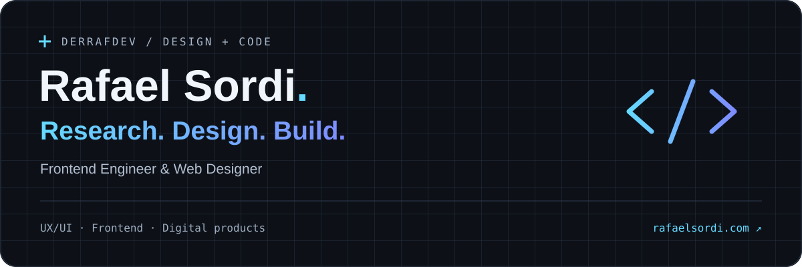

[](https://rafaelsordi.com)

<p align="center">
  <a href="https://rafaelsordi.com"></a>
  &nbsp;
  <a href="https://www.linkedin.com/in/rafael-sordi/"></a>
</p>

## Design-minded. Code-driven.

I'm **Rafael Sordi**, a Frontend Engineer and Web Designer with a background in UX/UI Design. I bring design, development, and product thinking together to build intuitive digital experiences.

Since 2020, I've worked on websites, interfaces, and digital products for clients across different industries and markets. I enjoy turning complex ideas into clear interfaces — with care for usability, performance, and the details that make a product feel right.

## A little more about me


```typescript
const rafael = {
  name: "Rafael Sordi",
  handle: "DerRafDev",
  focus: ["Frontend", "Web Design", "UX/UI"],
  code: ["TypeScript", "JavaScript", "HTML", "CSS"],
  buildWith: ["React", "Astro", "Tailwind CSS"],
  design: ["Figma", "Design Systems", "Prototyping"],
  mindset: "Research. Design. Build.",
} as const;
```

<br clear="both">

## Tech & tools

| Area | Stack |
| :--- | :--- |
| Frontend | TypeScript · JavaScript · React · Astro · HTML5 · CSS3 · Tailwind CSS |
| Design & product | Figma · UX/UI · Design Systems · Wireframing · Prototyping |
| Web craft | Responsive Design · Accessibility · Performance · SEO · API Integration |
| Tools & platforms | Git · GitHub · Cloudflare · Framer · WordPress |

## How I approach a project

**01 — Research** · Understand the people, the problem, and the product goals.  
**02 — Design** · Turn insights into clear flows and thoughtful interfaces.  
**03 — Build** · Bring the experience to life with reusable components and attention to performance.

## Let's connect

Interested in frontend engineering, web design, or the space where design meets code? Let's talk.

[Explore my portfolio →](https://rafaelsordi.com) &nbsp; · &nbsp; [Connect on LinkedIn →](https://www.linkedin.com/in/rafael-sordi/)

---

<sub>Thoughtful experiences, from the first idea to the last pixel.</sub>
