[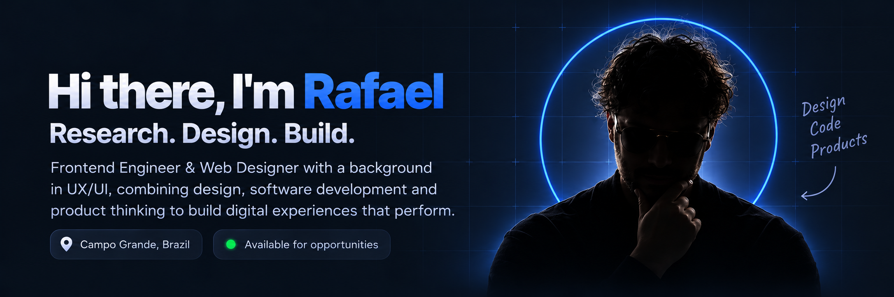](https://rafaelsordi.com)

<table>
<tr>
<td width="70%" valign="top">

<h2>A little more about me...</h2>

I'm <strong>Rafael Sordi</strong>, a Frontend Engineer and Web Designer with a background in UX/UI Design. Since 2020, I've worked on websites, interfaces, and digital products for clients across different industries and markets.

I bring design, development, and product thinking together to turn complex ideas into clear, intuitive digital experiences — with care for usability, performance, and the details that make a product feel right.

<pre lang="typescript"><code>const rafael = {
  name: "Rafael Sordi",
  handle: "DerRafDev",
  focus: ["Frontend", "Web Design", "UX/UI"],
  code: ["TypeScript", "JavaScript", "HTML", "CSS"],
  buildWith: ["React", "Astro", "Tailwind CSS"],
  design: ["Figma", "Design Systems", "Prototyping"],
  mindset: "Research. Design. Build.",
} as const;</code></pre>

</td>
<td width="30%" valign="top" align="center">

 

  

  

</td>
</tr>
</table>

## Tech stack

  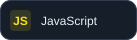
  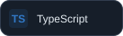
  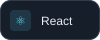
  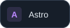
  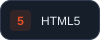
  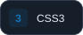
  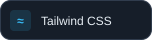
  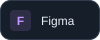
  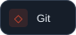
  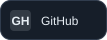
  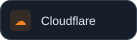
  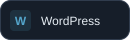
  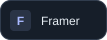
  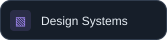
  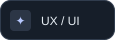

## Let's connect

Interested in frontend engineering, web design, or the space where design meets code? Let's talk.

[Explore my portfolio →](https://rafaelsordi.com) &nbsp; · &nbsp; [Connect on LinkedIn →](https://www.linkedin.com/in/rafael-sordi/)

---

Thoughtful experiences, from the first idea to the last pixel.
